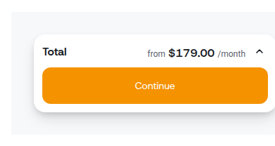
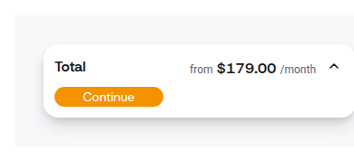
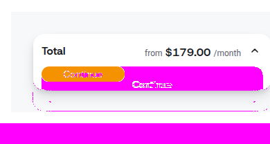

# Visual testing pilot — Testplane on the Reboost Storybook

Two automated passes over every Storybook story, at two widths (desktop 1280, phone 390):

| Pass | Question | Tool | Output |
|---|---|---|---|
| **visual** | what changed since the reference? | `@testplane/storybook`: one screenshot test per story, `assertView` against a reference image | Testplane HTML report: reference, current, diff; accept or reject per image |
| **layout** | what is broken now, whatever the reference? | `tests/layout.testplane.js`: `scripts/live-checks.js` + axe-core inside every story | one JSON per story and browser, `reports/<product>/layout-summary.md` grouped by catalog ID |

Then the critic triages: a changed image or a finding is read with the review method and the
product layer, and becomes an accepted change, a filed defect (`templates/bug-report.md`) or a
`decision-needed` item. The layout pass catches what was already broken in the reference; the
visual pass catches what a rule cannot express (a primary button that lost its weight).

## Run

```bash
npm install
# a Storybook: the dev server, or a static build served over HTTP
export STORYBOOK_URL=http://127.0.0.1:6006
# a browser: "local" lets Testplane fetch one; or start chromedriver yourself
export GRID_URL=http://127.0.0.1:9515 CHROME_BIN=/path/to/chrome   # optional
export PRODUCT=reboost                                              # reboost | doktorabc | mobile-app

npm run visual:update   # first run: save the reference images
npm run visual          # later runs: compare; report in reports/<product>/html-visual
npm run visual:gui      # review and accept changes in the browser
npm run layout          # layout checks + summary in reports/<product>/layout-summary.md
STORIES='^primitives-button' npm run layout   # a subset by story id
```

References are stored per product and browser: `screens/<product>/<browser>/<test>/plain.png`.
They belong next to the product's code (in the Reboost case, the beluga-ds repository), not in
this one; `screens/` and `reports/` are ignored here.

## First run on Reboost (beluga-ds 9ccb91b, 2026-10-20)

349 stories × 2 widths = 698 renders in 2 min 45 s on one machine.

**Layout pass:** 877 blocking, 181 warning, 23 note (before the target-size recommendation
checks were added). Almost all of it is a handful of colour tokens:

| Token | Pairs measured | Contrast | Hits |
|---|---|---|---|
| `text/disabled` (`#9AA1AE`, `#ADA69B`) used on live text: field labels, subtitles | on white, `#F7F8FA`, `#FEFDFB` | 2.3–2.6 : 1 | ~370 |
| brand orange `#F59200` (`fill/primary`, `text/brand`) | white on orange; orange on white and `#F7F8FA` | 2.0–2.3 : 1 | ~270 |
| `text/success` `#1FA971`, `text/error` `#E5484D` | on white, `#F7F8FA` | 2.8–3.9 : 1 | ~90 |

The rule is L-01 (lens 03 · Contrast floors, measured on the rendered pair, blocking). Fixing
the tokens, not the 151 stories, clears most of it. Also found: 56 controls with no accessible
name (K-07: icon buttons, switches, checkbox buttons in photo tiles), 20 × 20 px checkboxes in
photo tiles (A-03, below the 24 px floor), the OTP input with no label (D-02).

**Visual pass, with a planted regression.** References for 30 tests (button, checkout total
card, order summary card), then the default button size changed to
`h-[22px] px-2 max-w-[120px] overflow-hidden` and Storybook rebuilt:

- the visual pass failed 23 of 30 tests;
- the layout pass on the same stories reported 34 new findings against its baseline run: the
  button is 22 px tall (A-03, below the 44 px touch and 32 px desktop recommendations) and its
  label is cut off with no ellipsis (I-06, blocking).

Example triage, `Commerce/CheckoutTotalCard/Collapsed`, phone:

| Reference | Current | Diff |
|---|---|---|
|  |  |  |

> **Not an accepted change — file it.** The card’s primary action shrank from a full-width
> 52 px button to a 120 × 22 px pill. Measured: A-03, 22 px tall against the 44 px touch
> recommendation (lens 10 · Target size, warning). Read: the primary action lost its weight on
> the card (lens 04 · The primary action is the screen's verb), against the Reboost layer’s
> “CTA spans the full column” (design-decisions, desktop funnel step). Against: implementation.

## Limits found in the pilot

- **Story frames are not pages.** A component in a fixed-width decorator (360 px plus 24 px
  Storybook padding) scrolls sideways on a 390 px phone by construction; the reflow check runs
  only on `layout: fullscreen` stories, and real reflow belongs to page-level runs.
- **Sticky and fixed layers** cover content only at some scroll positions; overlaps across them
  are skipped. An icon inside a field (clear, reveal, calendar) is one control, not an overlap.
- **The 24 px floor** has a spacing exception (WCAG 2.5.8), applied by axe; the lens's
  recommendations above the floor are warnings from the checks.
- One test (`CheckoutTotalCard/Expanded`, desktop) could not be captured: Testplane could not
  compute the screenshot area.
- Contrast of text over images and gradients is reported by axe as "needs review" and is not in
  the findings.

## Next

1. Put the Testplane config and references into beluga-ds and run both passes on its pull
   requests; a PR comment lists new findings and changed images.
2. Page-level runs on staging (checkout flow, questionnaire) with real reflow and keyboard checks.
3. Figma ↔ build: compare tokens and sizes from the Figma file with computed styles.
4. A product's `Live` section in its layer: Storybook and staging URLs, Figma file, widths, where
   references live; then the same pilot for DoktorABC and Mobile App.
